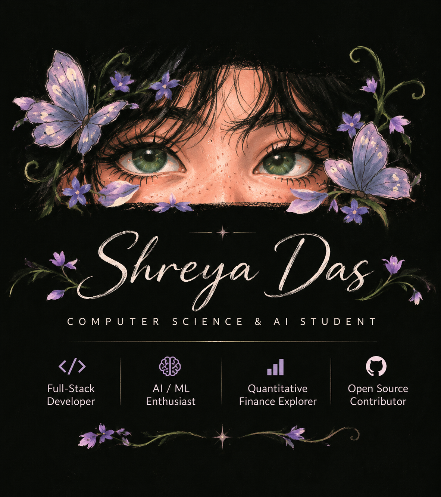

  

  

---
  
## About Me

- B.Tech student in **Computer Science & Artificial Intelligence** at Newton School of Technology, Rishihood University.
- Interested in **software engineering, full-stack development, AI/ML, and open source**.
- Exploring **quantitative finance**, computational methods, and data-driven financial research.
- Enjoy solving problems with **Data Structures & Algorithms**.
- Currently strengthening my skills in backend development, databases, and applied machine learning.
- I believe in learning by building, contributing, and consistently improving.
---
## Areas of Interest

- Data Structures & Algorithms
- Full-Stack & Backend Development
- Artificial Intelligence & Machine Learning
- Quantitative Finance & Financial Computing
- Open Source Software

---
<h2 align="center">Tech Stack</h2>

  

---

<h2 align="center">✦ GitHub Activity ✦</h2>

  <table>
    <tr>
      <td width="50%" align="center">
        
      </td>
      <td width="50%" align="center">
        
      </td>
    </tr>
  </table>

  

---

<h2 align="center">✦ Profile Visitors ✦</h2>

  

---

  

---
<h2 align="center">✦ Connect With Me ✦</h2>

  
  

---

*Build. Learn. Contribute. Repeat.* ✨

